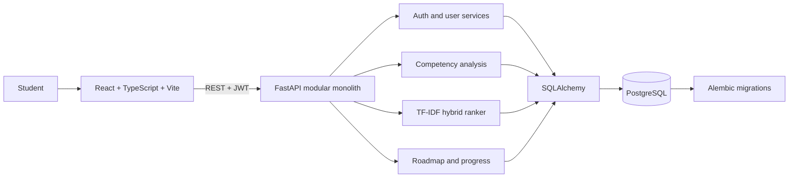

# AI-Enabled Learning Platform

**Competency Gap Identification and Personalized Learning Recommendations**

An academic full-stack prototype that helps students compare self-assessed technical skills with sample career role profiles, understand weighted competency gaps, explore explainable learning resources, and track roadmap progress.

> The abstract and PowerPoint mentioned in the original request were not available in the workspace at build time. This implementation follows the prompt's stated objectives. Role requirements and resource examples are synthetic and illustrative, not verified employer data. The recommender is deterministic and has not been trained or evaluated as a predictive model. Alignment is not employment probability.

## Problem and objectives

Students often need help turning a target role into a concrete learning plan. This app brings skill assessment, role comparison, resource ranking, roadmaps, and saved progress into one workflow. Objectives include secure accounts, extensible skill data, weighted skill analysis, transparent ranking explanations, responsive visual analytics, and reproducible deployment.

## Features

- Student registration, bcrypt password hashing, JWT access tokens, and protected routes.
- Skill ratings on a 0–5 scale with timestamped retake history.
- Eight sample career paths and per-skill suggested levels and weights.
- Weighted competency alignment and priority gap analysis.
- Explainable TF-IDF/cosine plus gap, difficulty, and skill-tag resource ranking.
- Persisted roadmap generation, status updates, and progress analytics.
- Admin-protected API endpoints for users and resource creation.
- OpenAPI docs, Alembic schema migration, Docker Compose, and GitHub Actions.

## Architecture



## Stack

| Layer | Technology |
|---|---|
| Frontend | React 18, TypeScript, Vite, Tailwind CSS, Recharts, Axios, React Router |
| Backend | Python 3.11, FastAPI, Pydantic, SQLAlchemy 2, Alembic, JWT, Passlib/bcrypt |
| Recommendation | Pandas/NumPy/scikit-learn; deterministic TF-IDF and cosine hybrid ranking |
| Storage | PostgreSQL 16; SQLite fallback for local quick start |
| Delivery | Docker Compose, Nginx, GitHub Actions, Pytest |

## Database and AI methodology

The normalized entities cover users/profiles, skills, roles/requirements, assessment snapshots/ratings, learning resources, persisted recommendations, roadmaps/items, progress records, and model metadata. The ERD is in `docs/database_design.md`.

The gap formula is `max(0, recommended_level - current_level)`. Weighted alignment is `100 × Σ(weight × min(current, recommended)) / Σ(weight × recommended)`, returning zero for a zero denominator. Missing ratings are level zero. Recommendation weights are documented in `docs/ai_recommendation_methodology.md`. No trained model or accuracy metric is claimed.

## Quick start

### Local development with SQLite

Requires Python 3.11+ and Node.js 20+.

```powershell
cd ai-learning-platform/backend
python -m venv .venv
.\.venv\Scripts\Activate.ps1
pip install -r requirements.txt
uvicorn app.main:app --reload
```

In another terminal:

```powershell
cd ai-learning-platform/frontend
npm install
npm run dev
```

Open `http://localhost:5173`. API docs are at `http://localhost:8000/docs`. The default SQLite database is created in `backend/learning_platform.db` and ignored by Git. Set a strong `SECRET_KEY` in a local `.env` for non-demo use. For direct Alembic use, run `alembic upgrade head` from `backend` before starting the API.

### Docker Compose with PostgreSQL

Copy `.env.example` to `.env`, replace local values, then:

```powershell
docker compose up --build
```

Open `http://localhost:8080`; API docs are at `http://localhost:8000/docs`. The `postgres_data` volume preserves database contents. Compose values shown as defaults are local demonstration values; replace them before exposing services.

## Testing and checks

```powershell
cd backend
pip install -r requirements.txt
pytest -q
```

```powershell
cd frontend
npm install
npm run build
```

Tests exercise account/auth flow and assessment → analysis → recommendations → roadmap → progress. No results are stated here unless those commands have actually been run. CI also runs Ruff and the frontend production build.

## Deployment

See [`docs/deployment.md`](docs/deployment.md) for a walkthrough using Neon PostgreSQL, Render, and Vercel. Configure `VITE_API_URL`, `DATABASE_URL`, `SECRET_KEY`, and `CORS_ORIGINS` for the actual hostnames. The deployment is not live until these provider steps are completed.

## API

Routes are documented in `docs/api_documentation.md`. Interactive OpenAPI documentation is available at `/docs` while the API runs.

## Documentation

- `docs/architecture.md` – component architecture
- `docs/database_design.md` – entity relationships
- `docs/api_documentation.md` – endpoints and access model
- `docs/ai_recommendation_methodology.md` – formulas and evaluation limitations
- `docs/project_report.md` – academic report draft
- `docs/viva_questions.md` – 20 viva questions and answers

## Screenshots

Capture and add screenshots after running the application with demonstration data. No unverified or fabricated screenshots are included.

## Future scope

Validate skill requirements with domain experts, include consented real interaction data and relevance judgments, evaluate ranking with offline metrics, add objective assessments, provide admin UI workflows, and strengthen token revocation and deployment hardening.

## GitHub

See `CONTRIBUTING.md` for development conventions and the end of this README for Windows push commands.

## License

MIT. See `LICENSE`.

### Publish to your GitHub repository (PowerShell)

1. Create a new empty repository on GitHub and copy its HTTPS URL.
2. In PowerShell, change to this project directory. Configure Git identity if needed with `git config --global user.name "Your Name"` and `git config --global user.email "you@example.com"`.
3. Run:

```powershell
git init
git add .
git commit -m "Initial commit: AI-enabled learning platform"
git branch -M main
git remote add origin YOUR_GITHUB_REPOSITORY_URL
git push -u origin main
```

GitHub will use its normal browser/device authentication or credential manager flow. Do not paste passwords or tokens into chat. Verify files on the repository page. For later updates, use `git add .`, `git commit -m "Describe the change"`, and `git push`.
