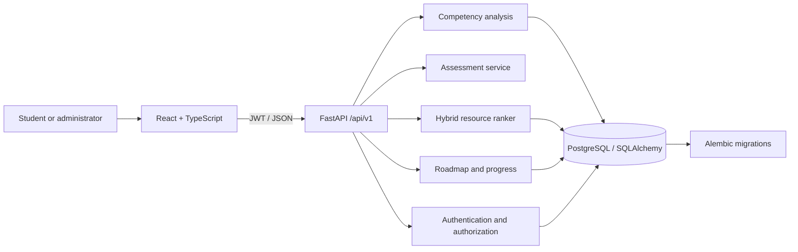

# System architecture

The application is a modular monolith. React/TypeScript presents the student workspace and calls a versioned FastAPI REST API. FastAPI delegates competency comparisons and resource ranking to focused service modules. SQLAlchemy maps application entities to PostgreSQL; SQLite is the zero-service local fallback. Alembic owns schema revisions. Docker Compose starts PostgreSQL, API, and static frontend together.

## Service boundaries

- `app/api.py` validates HTTP input and delegates to services.
- `app/services/analysis.py` applies weighted competency calculations.
- `app/services/recommender.py` combines TF-IDF cosine similarity, gap size, level fit, and explicit skill tags.
- `app/models.py` contains normalized persistence models.
- `app/seed.py` provides clearly marked synthetic catalog and role examples.

The ranker is deterministic content-based logic. There is no learned model and no claim of recommendation accuracy. Real interaction logs and expert-labeled relevance judgments would be required to train and evaluate a supervised or collaborative model.
