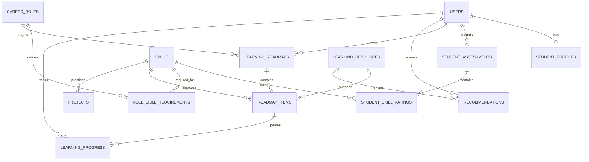

# Database design

The join tables `role_skill_requirements` and `student_skill_ratings` hold relationship-specific values and enforce uniqueness. Role requirements store the suggested and minimum levels, a weight, and illustrative industry relevance. Projects hold practice assignment metadata and can reference a skill. Users have one optional student profile, many assessment snapshots, and many roadmap instances. Assessment ratings are immutable snapshots at the API level so a retake preserves history. Resource recommendation scores and explanations are persisted. Progress events link a student to a roadmap item. `model_metadata` records the deterministic ranker version and explicitly records `trained=false`.

The ORM defines primary and foreign keys, uniqueness, indexes for lookup relationships, and cascading deletion for student-owned records. Alembic migration `0001_initial` builds the schema from the SQLAlchemy metadata. Sample data is loaded on API startup in this prototype.
