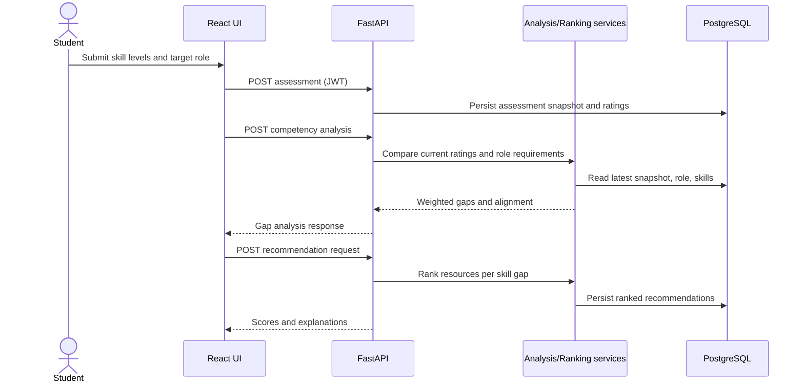

# AI Enabled Learning Platform
## Competency Gap Identification and Personalized Learning Recommendations

**Academic project report draft · 30 October 2026**

> Source material note: the requested abstract and PowerPoint were not present in the supplied workspace at implementation time. This report follows the objectives in the project prompt and must be reconciled with the original academic documents when they are provided.

## 1. Abstract

Students often have difficulty translating a career goal into a concrete learning plan. This project implements a web platform that records student self-assessments on technical skills, compares them with sample competency profiles for career roles, identifies weighted gaps, recommends relevant learning materials, and generates a sequenced roadmap. The modular monolith uses React and TypeScript, FastAPI, SQLAlchemy, Alembic, and PostgreSQL, with SQLite available for a local demonstration. Its recommender combines TF-IDF cosine relevance with explicit gap priority, difficulty fit, and skill-tag matching. It is deterministic and explainable; no trained model or measured accuracy is claimed. Role requirements and the resource catalog are synthetic examples and require validation against real curricula or employer evidence before operational use.

## 2. Introduction

Technical career preparation involves many competencies whose importance varies by role. A list of courses alone does not tell a student which gap to address first. The system joins a student profile, a structured skill taxonomy, a chosen career role, and learning-resource metadata to provide an inspectable comparison. Students can update self-assessments and track roadmap completion over time.

## 3. Problem Statement

Students lack a single transparent workflow to compare current skills with target-role expectations, identify priority gaps, and connect those gaps to practical learning activities. Static advice can overlook a student's starting level and gives little evidence of progress.

## 4. Objectives

The project aims to provide secure student accounts, extensible skill assessment, role-to-skill mappings, weighted gap analysis, explainable hybrid recommendations, personalized roadmaps, persisted progress analytics, and administrator-protected catalog operations. It also aims to provide reproducible local setup and an academic demonstration that distinguishes real implementation from synthetic assumptions.

## 5. Literature Review

The design draws on established information retrieval concepts: TF-IDF represents term importance in a document collection, and cosine similarity compares vector direction. Content-based filtering uses item features to find resources related to a learner's stated needs. Hybrid ranking can combine semantic-content signals with explicit domain rules, though the chosen weights require empirical evaluation. The prototype prioritizes explainability and determinism over claims of personalization learned from user behavior.

Suggested foundational references for verification and final institutional formatting: Salton and Buckley, “Term-weighting approaches in automatic text retrieval,” Information Processing & Management, 1988; Manning, Raghavan, and Schütze, Introduction to Information Retrieval, Cambridge University Press, 2008; Ricci, Rokach, and Shapira (eds.), Recommender Systems Handbook, 3rd ed., Springer, 2022; FastAPI official documentation; SQLAlchemy 2.0 documentation; scikit-learn feature extraction and pairwise metrics documentation. Confirm the exact editions, page details, and citation format required by the institution before submission.

## 6. Existing System

Common alternatives include generic course catalogs, manual career checklists, and unpersonalized recommendations. They can be useful references, but do not necessarily connect student ratings, role-weighted gaps, explanations, and progress history in one workflow. This is a project framing, not a comparative product benchmark.

## 7. Proposed System

The proposed web application supports student registration and login, a skill catalog, 0–5 self-rating snapshots, sample career profiles, weighted comparison, ranked course/project suggestions, roadmap generation, and persisted activity summaries. Administrator endpoints are separated by role checks. The system is a modular monolith rather than a microservice deployment.

## 8. Feasibility Study

**Technical:** all components have local development paths and open-source runtimes; PostgreSQL is available through Docker and SQLite supports a no-container demonstration. **Operational:** the student workflow is designed for self-service with explicit explanations and editable ratings. **Economic:** local execution requires no paid API or cloud service. **Schedule:** deliverables can be built incrementally as described in the repository README. These are project-level feasibility observations, not a formal procurement or institutional impact study.

## 9. Requirements

Functional requirements include account creation, login, assessment history, role selection, gap analysis, recommendation ranking and explanations, roadmap generation/status, analytics, and admin resource/user access. Nonfunctional requirements include input validation, hashed passwords, token expiry, role-based access control, modular source structure, database migration support, API documentation, reproducible packaging, and responsive interface behavior.

## 10. System Architecture

The frontend calls FastAPI over JSON and bearer tokens. The API uses application services for analysis and recommendations. SQLAlchemy persists users, profiles, skills, career roles, requirements, assessments, resources, recommendation explanations, roadmaps, progress, and model metadata. PostgreSQL is the Compose default. See `architecture.md` for a Mermaid diagram.

## 11. Database Design

The normalized schema separates users from student profiles and role requirements from skills. Assessment snapshots are parent records for skill ratings. Roadmap instances contain ordered roadmap items that refer to skills and learning resources. Recommendation rows preserve ranker outputs and explanations. Unique constraints prevent duplicate ratings per assessment and duplicate skill requirements per role. See `database_design.md` for the ER diagram.

## 12. UML and Data Flow Diagrams

## 13. Methodology

The student selects a target career profile and submits ratings from zero to five. The service fetches the latest assessment, treating missing skills as zero. For each requirement it computes a nonnegative gap and priority. The ranker generates a text query for each positive gap and scores candidate resources. The roadmap sorts skills by weighted gap and associates the best resource found. Subsequent status changes are stored against the student's own roadmap item.

## 14. AI/ML Algorithms

The text portion uses `TfidfVectorizer` and cosine similarity. The ranking function is `0.50 × text similarity + 0.35 × normalized gap + 0.10 × difficulty fit + 0.05 × explicit tag match`. This is an engineered, interpretable heuristic; it has not been trained or evaluated on user behavior. The score is not a probability. The exact formula and evaluation plan are documented in `ai_recommendation_methodology.md`.

## 15. Implementation

The backend defines SQLAlchemy entities and Pydantic request validation, JWT authentication, password hashing, user-scoped roadmap actions, role-protected admin routes, and REST endpoints under `/api/v1`. The frontend uses reusable React views, responsive styles, charts, loading and empty states, and an Axios token interceptor. Alembic has an initial schema migration. Docker Compose starts the database, API, and Nginx-served frontend. Synthetic catalog data is loaded by the backend seed function.

## 16. Testing and Results

The repository includes integration tests for registration/login, protected access, assessment submission, competency analysis, recommendations, roadmap creation/status changes, and request validation. No test result is claimed until the test suite has been run in a compatible environment. This report should be updated with the actual command, environment, and observed outcome after execution.

## 17. Output Screenshots

Capture screenshots only from a running application after test data is entered. No screenshots are included in this draft because no running UI capture has yet been verified. Suggested captures: login, student overview after an assessment, skill comparison, recommendation explanations, and roadmap progress.

## 18. Conclusion

The implemented prototype connects skills, sample role requirements, resource ranking, and progress within one application. It demonstrates an explainable recommendation method and a deployable software architecture while making the limitations of synthetic role/resource data explicit.

## 19. Limitations

Ratings are self-reported, sample role thresholds are illustrative, resource quality is not curated through a formal review process, and the hybrid ranker has no trained component or validated relevance metrics. JWT logout is client-side token discard rather than server revocation. The current admin interface is API-only, and admin account provisioning requires a controlled bootstrap. The current UI uses external Google Fonts, with system sans-serif fallback.

## 20. Future Scope

Add validated curricula and employer-reviewed skill frameworks, objective assessment evidence, consented interaction events, offline ranking evaluation, recommendations that account for prerequisites and learner time budgets, admin catalog screens, refresh/revocation token handling, richer progress events, accessibility audits, and deployment-specific security hardening.

## 21. References

1. Salton, G. and Buckley, C. “Term-weighting approaches in automatic text retrieval.” Information Processing & Management, 24(5), 1988.
2. Manning, C. D., Raghavan, P., and Schütze, H. Introduction to Information Retrieval. Cambridge University Press, 2008.
3. Ricci, F., Rokach, L., and Shapira, B. (eds.). Recommender Systems Handbook, 3rd ed. Springer, 2022.
4. FastAPI documentation, https://fastapi.tiangolo.com/ (accessed 30 October 2026).
5. scikit-learn documentation, feature extraction and pairwise metrics, https://scikit-learn.org/stable/ (accessed 30 October 2026).
6. SQLAlchemy 2.0 documentation, https://docs.sqlalchemy.org/ (accessed 30 October 2026).

Reference metadata and institutional formatting should be confirmed before academic submission. The included role/resource sample data is not a source of labor-market evidence.
